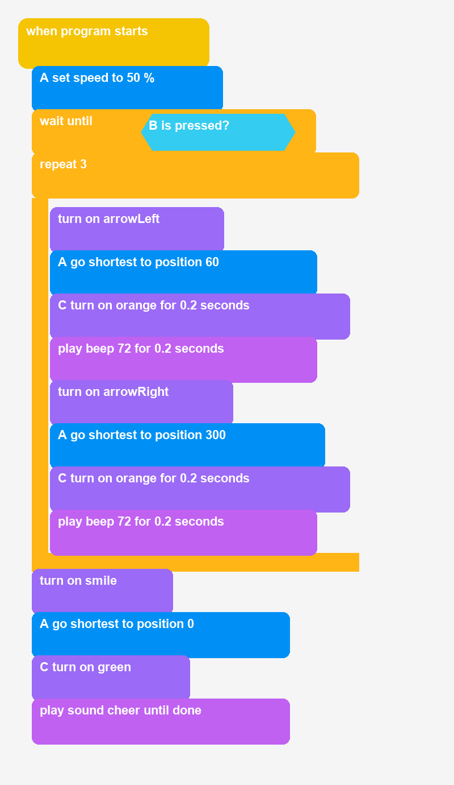

# Code -- Half-pipe Swing

SPIKE App, **Word Blocks** (per brief). The runnable spec is
[`program.spike`](program.spike). Check and picture:

```
python3 tools/blocks.py check builds/halfpipe-swing
python3 tools/blocks.py preview builds/halfpipe-swing
python3 tools/blocks.py render builds/halfpipe-swing
```

Open `program.html` and click through it before Figma. The SVG in
`renders/program.svg` is what Figma imports. See
[`context/spike-blocks.md`](../../context/spike-blocks.md) for why a
"pressed?" hexagon does nothing until it sits inside `wait until`.



## Ports

| Port | Device | Role |
|---|---|---|
| A | Large Motor | Swings the arm -- Leo -- about its own axle |
| B | Force Sensor | The drop-in button |
| C | 3x3 Color Light Matrix | The lights on the front, facing Ian |

The motor port bubble is a multi-select. Only A is plugged in, so only A
should be ticked on the three motor blocks.

Two different lights, two different blocks, both purple:

- **turn on [arrow]** with no port letter is the Prime hub's own **5x5**,
  lying flat on top of the hub.
- **C turn on [colour]** is the **3x3 Color Light Matrix** from the
  Essential set, plugged into port C. It works on the Prime hub too; its
  blocks show up once it is plugged in.

## Success

Put Leo at the bottom and press **run**. Nothing moves. Press the button:
Leo drops in toward one lip -- arrow on the hub -- and at the top the
front lights flash orange and it beeps. Then he swings to the other lip,
three times each way, flash and beep at every lip. On the last swing he
comes back to the middle, the front lights go green, the hub smiles, and
it plays a cheer.

Watch the gears under the board: they roll along the teeth of both rails
the whole way, four turns of the gear for every turn of the swing.

## Building it with Ian

Seventeen blocks, eleven kinds, top to bottom. Chris reads; Ian finds
and drags.

1. **when program starts** (yellow, Events).
2. **A set speed to 50 %** (blue, Motors). Change 75 to 50.
3. **wait until** (orange, Control), then drop **B is pressed?** (light
   blue, Sensors) into its hexagon slot. Change the port to B.
4. **repeat 3** (orange, Control). Change 10 to 3. Everything in steps 5-6
   goes *inside* its mouth.
5. Inside: **turn on** (purple, Light) -- tap the picture and pick an
   arrow -- then **A go shortest to position 60** (blue, Motors), then
   **C turn on for 0.2 seconds** (purple, Light, the one with a port
   letter) -- set the port to C, tap the squares and make them all
   orange -- then **play beep 72 for 0.2 seconds** (pink, Sound).
6. Still inside, the same four again: the arrow pointing the other way,
   position **300**, the same orange flash, the same beep.
7. Below the repeat, not inside it: **turn on** a smile, **A go shortest
   to position 0**, **C turn on** with all nine squares green (the one
   *without* "for seconds", so it stays on), **play sound until done** --
   pick any cheer from the sound library (the file says `cheer`; any
   happy sound is right).

## Program notes

- **Positions, not turns.** "Go to position" uses the motor's own
  compass, 0 to 359, with 0 at the marks on the disc and body lining up.
  60 is one lip and 300 is the other -- "60 the other way" is the
  sentence for Ian. Because every move names *where* to go, not *how
  far*, the last block always lands Leo in the middle, even if a swing
  was cut short by a hand in the way.
- **Shortest.** From 60 to 300 the short way is back through 0 (120
  degrees), not over the top (240). Clockwise or counterclockwise here
  would send Leo the long way round, through the frame.
- **Which arrow is which.** Seen from the front, the motor turning to 60
  carries Leo to Ian's **left**. The hub lies flat behind the motor, so
  whether the hub's left arrow points the same way as Leo depends on how
  the 5x5 is turned. If the arrows point away from Leo, swap the two
  pictures -- that is a good first debugging job for Ian.
- **Speed 50%.** See `preflight.md`. Faster is more exciting and is the
  obvious first change to try; go up 10 at a time.
- **Flash, then beep.** "for 0.2 seconds" waits while the lights are on,
  so Leo pauses at the top with the lights lit -- that pause is his
  trick in the air. Making the two lips different colours is a good
  second change.
- **The button is pressed once.** `wait until` only lets the program
  through once. To go again, press run again -- or wrap everything after
  `set speed` in a `forever` as a next step.

Word Blocks only for this brief. The Prime Python equivalent of the
button test is `force_sensor.pressed(port.B)`, and of the front lights
`color_matrix.show(port.C, pixels)`.
